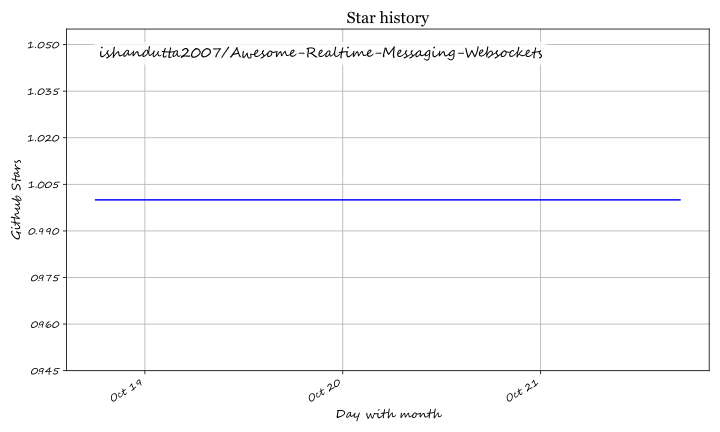

  

  
  
  
  
  
  
  

---

# ⚡ Awesome Realtime Messaging & WebSockets Ecosystem

> 🌐 **Curated List of SaaS Platforms, Self-Hosted Infrastructure & Open-Source Projects**  
> *Targeted at Bidirectional Pub/Sub, Connection Continuity, Presence, Resilient Streaming, and Scalable WebSocket Servers.*

This repository tracks the modern **real-time communication ecosystem**, including **fully managed cloud SaaS platforms** and **battle-tested open-source engines**. These technologies push data to connected clients instantaneously — powering live chat, collaborative whiteboards, multiplayer gaming, financial tickers, notifications, and AI agent streaming without inefficient HTTP polling.

---

## 📑 Table of Contents

- [📈 Sector Overview & Market Dynamics](#-sector-overview--market-dynamics)
- [☁️ Managed SaaS & Hosted Platforms](#️-managed-saas--hosted-platforms)
- [💻 Open-Source Realtime & WebSocket Projects](#-open-source-realtime--websocket-projects)
- [🔬 Architectural Comparison: WebSockets vs. SSE vs. Polling](#-architectural-comparison-websockets-vs-sse-vs-polling)
- [🤝 How to Contribute](#-how-to-contribute)
- [⭐ Star History](#-star-history)
- [💖 Support & Sponsorship](#-support--sponsorship)
- [📜 Disclaimer](#-disclaimer)

---

## 📈 Sector Overview & Market Dynamics

* **Estimated Market Size**: The global real-time communication and messaging infrastructure market is valued at approximately **$4.8 Billion** and is projected to expand beyond **$17.3 Billion by 2030**, recording a compound annual growth rate (**CAGR**) of **~23.8%**. This expansion is fueled by the explosive adoption of generative AI streaming interfaces, live interactive audio/video, multiplayer spatial software, and distributed IoT telemetry.
* **Market Concentration & Fragmentation**: The sector is **moderately fragmented** rather than a winner-take-all monopoly. While hyperscale cloud providers (**Amazon AWS**, **Google Firebase**) control foundational cloud defaults, independent developer platforms (**Pusher**, **Ably**, **PubNub**) and high-growth open-core platforms (**Supabase**, **Centrifugo**) capture high-value workloads. Engineering teams frequently avoid hyperscaler lock-in due to high connection and egress fees, sustaining a competitive multi-vendor landscape with heavy reliance on open standards and self-hosted fallback architectures.

---

## ☁️ Managed SaaS & Hosted Platforms

The following hosted platforms provide managed infrastructure with global edge routing, automatic failover, and client SDKs. Platforms are **sorted in descending order by company valuation / market capitalization**.

| 🏷️ Platform | 🏢 Company Size & Valuation | 🎁 Free Tier Limit (Specific) | 💳 Paid Starting Price (Specific) | 🚀 Core Capabilities & Real-Time Protocols |
| :--- | :--- | :--- | :--- | :--- |
| **[AWS AppSync](https://aws.amazon.com/appsync/)** | **~$2.1 Trillion** *(Amazon Market Cap, $575B+ Annual Rev)* | **Free for 12 months** on AWS Free Tier: **250,000 query/mutation operations**, **250,000 real-time updates**, and **1,000,000 connection minutes/month**. | **$4.00 per million** query/mutation operations + **$0.08 per million** connection minutes + **$2.00 per million** real-time updates. | Fully managed GraphQL & Pub/Sub subscriptions over WebSockets; native IAM/Cognito auth; direct resolvers to DynamoDB, Lambda, and EventBridge. |
| **[Firebase Realtime Database](https://firebase.google.com/)** | **~$2.0 Trillion** *(Alphabet/Google Market Cap, $307B+ Annual Rev)* | **Spark Plan (Free Forever)**: **100 simultaneous connections**, **1 GB stored data**, and **10 GB/month data transfer**. | **Blaze Plan (Pay-as-you-go)**: **$1.00/GB storage/month**, **$0.18/GB downloaded**, and **$0.025 per 100K concurrent connections** (charges begin only above free quotas). | NoSQL document state sync with low-latency client SDKs; offline data persistence; automatic failover; deep native integration with Cloud Functions. |
| **[Pusher Channels](https://pusher.com/)** | **~$3.8 Billion** *(Parent Bird / MessageBird Valuation; $600M+ Annual Rev)* | **Sandbox Plan (Free Forever)**: **200,000 messages/day** and **100 concurrent connections** (connections block and publish returns 403 when daily cap is reached). | **$49.00/month (Startup Plan)**: **1,000 concurrent connections** and **1,000,000 messages/day**; scales to Pro ($99/mo) and Business ($299/mo). | The reference Pub/Sub protocol; private, presence, and encrypted channels; webhooks; supported by dozens of third-party open-source implementations. |
| **[Supabase Realtime](https://supabase.com/)** | **~$1.0+ Billion** *(Series B Unicorn backed by Coatue, Lightspeed, YC)* | **Free Plan (Free Forever)**: **200 concurrent connections**, **100 messages/second**, and **2,000,000 messages/month**. | **$25.00/month (Pro Plan)**: **500 concurrent connections**, **500 messages/second**, and **50,000,000 messages/month** with usage overage metering. | Globally distributed Elixir/Phoenix cluster; PostgreSQL WAL CDC (logical replication slots), client-to-client Broadcast, and presence tracking. |
| **[PubNub](https://www.pubnub.com/)** | **~$450 Million - $500 Million** *(Valuation; $130M+ venture funding, ~$35M+ ARR)* | **Free Plan (Free Forever)**: **200 Monthly Active Users (MAUs)** or **1,000,000 transactions/month** (strictly limited to dev/test keysets). | **$49.00/month (Starter Plan)**: Up to **1,000 MAUs** and **100,000 transactions included**; additional transactions billed at **$0.05 per 1,000**. | Global 15-PoP Data Stream Network; integrated mobile push notifications (FCM/APNS bridging); serverless edge functions; presence indicators. |
| **[Ably Realtime](https://ably.com/)** | **~$250 Million** *(Valuation; $70M+ venture funding, ~$20M+ ARR)* | **Free Plan (Free Forever)**: **6,000,000 messages/month**, **200 concurrent connections**, **200 channels**, and **500 messages/second** (no daily hard quota). | **Pay-as-you-go starting at $2.50/million messages**, **$15.00 per 1,000 peak connections**, and **$1.50 per 1,000 peak channels** (committed tiers start at $199/mo). | 99.999% uptime SLA; mathematically guaranteed message ordering; connection state recovery with delta compression; multi-region mesh routing. |

---

## 💻 Open-Source Realtime & WebSocket Projects

Self-hosted and library solutions provide full data sovereignty, zero per-message SaaS charges, and complete protocol configurability. Projects are **sorted in descending order by GitHub Stars_Count**.

### 1. **[Socket.IO](https://github.com/socketio/socket.io)** 
* **License**: MIT | **Language**: TypeScript / Node.js
* **Overview**: The most popular event-based bidirectional communication library in the JavaScript ecosystem. Socket.IO builds on top of Engine.IO to provide HTTP long-polling fallback, automatic reconnection with backoff, room multiplexing, and binary message streaming. Multi-node horizontal scaling is achieved via the Redis or Nats cluster adapter.

### 2. **[gorilla/websocket](https://github.com/gorilla/websocket)** 
* **License**: BSD-2-Clause | **Language**: Go
* **Overview**: The gold-standard, idiomatic WebSocket protocol implementation (RFC 6455) for Go. Thoroughly tested against the Autobahn test suite, gorilla/websocket powers thousands of microservices requiring concurrent connection handling, efficient buffer reuse, and granular connection lifecycle hooks.

### 3. **[Yjs](https://github.com/yjs/yjs)** 
* **License**: MIT | **Language**: JavaScript
* **Overview**: High-performance Conflict-free Replicated Data Type (CRDT) library optimized for real-time collaborative text editing, state sync, and canvas tools. Communicates over WebSockets, WebRTC, and Dat, syncing complex data structures with automatic conflict resolution without centralized locking.

### 4. **[ws](https://github.com/websockets/ws)** 
* **License**: MIT | **Language**: JavaScript / Node.js
* **Overview**: Blazing-fast, ultra-lean, and RFC-compliant WebSocket client and server library for Node.js. It operates without extra protocol abstractions or custom frame formatting, making it the bedrock transport engine for hundreds of web frameworks and developer toolchains.

### 5. **[LiveKit](https://github.com/livekit/livekit)** 
* **License**: Apache-2.0 | **Language**: Go
* **Overview**: Complete real-time infrastructure platform for WebRTC video, spatial audio, and low-latency bidirectional data channels. Features automatic server-side SFU routing, integrated WebSocket signaling, and pre-built SDKs for mobile, web, React Native, Unity, and AI voice agents.

### 6. **[µWebSockets](https://github.com/uNetworking/uWebSockets)** 
* **License**: Apache-2.0 | **Language**: C++ / C
* **Overview**: Ultra-high-performance C++ WebSocket, HTTP, and Pub/Sub server engine engineered to sustain millions of concurrent socket connections with minimal CPU overhead and deterministic memory usage. Used in high-frequency trading terminals and gaming servers.

### 7. **[EMQX](https://github.com/emqx/emqx)** 
* **License**: Apache-2.0 | **Language**: Erlang / Elixir
* **Overview**: Massively scalable distributed MQTT and real-time messaging broker. Capable of handling over 100 Million concurrent IoT, automotive, and mobile client connections on an Erlang/OTP cluster with native WebSocket bridging and low-latency rule engines.

### 8. **[Centrifugo](https://github.com/centrifugal/centrifugo)** 
* **License**: Apache-2.0 | **Language**: Go
* **Overview**: Feature-rich, language-agnostic real-time messaging server. Exposes WebSocket, HTTP-streaming, Server-Sent Events (SSE), and WebTransport interfaces. Out-of-the-box features include channel history recovery, Redis/KeyDB clustering, delta compression, and native PostgreSQL/Kafka CDC outbox stream ingestion.

### 9. **[deepstream.io](https://github.com/deepstreamIO/deepstream.io)** 
* **License**: MIT | **Language**: TypeScript / Node.js
* **Overview**: Multi-model real-time data server providing three foundational primitives: schema-free synchronized JSON records, many-to-many event topics, and routed RPC calls with automatic failover. Integrates with PostgreSQL, MongoDB, Redis, and Memcached backends.

### 10. **[SocketCluster](https://github.com/SocketCluster/socketcluster)** 
* **License**: MIT | **Language**: JavaScript / Node.js
* **Overview**: Scalable real-time pub/sub and RPC framework optimized for multi-core processors and Kubernetes clusters. Features async-await generator streams, resilient reconnection recovery, and channel authorization hooks.

### 11. **[PartyKit](https://github.com/partykit/partykit)** 
* **License**: MIT | **Language**: TypeScript
* **Overview**: Modern developer platform for building multiplayer applications, collaborative canvasses, and real-time state machines on Cloudflare Workers edge compute. Pairs WebSockets with persistent storage primitives.

### 12. **[Soketi](https://github.com/soketi/soketi)** 
* **License**: AGPL-3.0 | **Language**: TypeScript / C++
* **Overview**: Ultra-fast, Pusher-compatible WebSocket server written in TypeScript with a C++ uWebSockets core. Operates as an instantaneous drop-in replacement for Pusher Channels, allowing existing client SDKs to run self-hosted with Redis horizontal clustering.

### 13. **[Mercure](https://github.com/dunglas/mercure)** 
* **License**: AGPL-3.0 | **Language**: Go
* **Overview**: Open, standards-based Server-Sent Events (SSE) hub implementing the Mercure protocol. Provides JWT authorization, connection multiplexing, and automatic message re-delivery over HTTP/2 and HTTP/3. First-class citizen in FrankenPHP, Symfony, and Laravel.

### 14. **[Primus](https://github.com/primus/primus)** 
* **License**: MIT | **Language**: JavaScript / Node.js
* **Overview**: Universal real-time abstraction wrapper for Node.js. Enables developers to build against a single API while seamlessly swapping low-level transports (ws, Engine.IO, SockJS, Faye) without changing business code.

### 15. **[Crossbar.io](https://github.com/crossbario/crossbar)** 
* **License**: AGPL-3.0 | **Language**: Python
* **Overview**: Unified application router implementing the open Web Application Messaging Protocol (WAMP). Bridges Publish/Subscribe messaging and routed Remote Procedure Calls (RPC) across polyglot microservices and browser clients over WebSockets.

### 16. **[Centrifuge](https://github.com/centrifugal/centrifuge)** 
* **License**: Apache-2.0 | **Language**: Go
* **Overview**: The high-performance Go real-time messaging library powering the Centrifugo server. Embed directly into existing Go applications to add bidirectional WebSocket and WebTransport connectivity without maintaining an external server process.

---

## 🔬 Architectural Comparison: WebSockets vs. SSE vs. Polling

| Feature | 🔌 WebSockets (`ws://`, `wss://`) | 📡 Server-Sent Events (`SSE`) | 🔄 HTTP Short/Long Polling | 🚀 WebTransport (HTTP/3) |
| :--- | :--- | :--- | :--- | :--- |
| **Directionality** | Full-duplex (Bidirectional) | Simplex (Server-to-Client only) | Unidirectional request-response | Full-duplex (Streams & Datagrams) |
| **Transport Protocol** | TCP (Upgrade from HTTP/1.1) | HTTP/1.1, HTTP/2, HTTP/3 | Standard HTTP/1.1 / HTTP/2 | QUIC (UDP) over HTTP/3 |
| **Header Overhead** | Minimal (2 to 10 bytes framing) | Standard HTTP response headers | Full HTTP headers per request | Low framing overhead |
| **Reconnection Logic**| Custom application / SDK logic | Built-in browser reconnection | Natural via next request loop | Built-in via QUIC connection migration |
| **Binary Data** | Native support (ArrayBuffer, Blob) | Text/UTF-8 only (Base64 encoding) | Base64 or multipart payloads | Native streams & datagrams |
| **Firewall / Proxy** | May require WebSocket-aware proxies | Standard HTTP traffic (passes easily) | Passes all enterprise firewalls | Requires UDP / HTTP/3 support |
| **Best Used For** | Gaming, chat, collaboration, RPC | AI token streaming, feeds, tickers | Low-frequency periodic polling | High-throughput gaming, AV, telemetry |

---

## 🤝 How to Contribute

We welcome additions, fixes, and ecosystem updates! To submit an entry:

1. 🍴 **Fork** this repository.
2. 📝 **Add or edit** entries in [`README.md`](README.md), adhering to the table format for SaaS or star-sorted list for open-source tools.
3. 🔍 **Verify**: Include official links, accurate licensing, exact pricing numbers, and realistic free tier quotas.
4. 🚀 **Submit a Pull Request** with a concise summary of changes.

---

## ⭐ Star History

---

## 💖 Support & Sponsorship

If this curated ecosystem guide helps you select the right real-time infrastructure, reduce your cloud latency, or migrate off expensive proprietary messaging tiers:

* ⭐ **Star this repository** to improve its visibility for fellow engineers.
* 🍴 **Fork and share** with your developer community.
* ☕ **Buy a coffee & sponsor** ongoing maintenance via the **[GitHub Sponsor Dashboard](https://github.com/sponsors/ishandutta2007)**!

Your sponsorship helps keep these benchmarks, pricing comparisons, and open-source lists updated with the latest releases and industry changes.

---

## 📜 Disclaimer

* This repository is a **community-curated reference** and is not affiliated with any cloud provider or commercial vendor.
* Quotas, pricing tiers, and SLA commitments reflect publicly listed figures as of **2026** and are subject to change by respective owners.
* Self-hosted solutions require appropriate cluster configuration (Redis, Valkey, NATS), WebSocket-aware reverse proxies (Nginx, Envoy, Traefik), and OS socket file-descriptor tuning (`ulimit -n 65535`) to achieve maximum concurrent throughput.

---

  <b>Built for platform engineers, distributed systems builders, and real-time application developers.</b> 
  Maintained with ❤️ by <a href="https://github.com/ishandutta2007">Ishan Dutta</a> and community contributors.

## Star History

<a href="https://star-history.com/#ishandutta2007/Awesome-Realtime-Messaging-Websockets&Timeline" align="center">
  <picture>
    <source media="(prefers-color-scheme: dark)" srcset="assets/ishandutta2007_Awesome-Realtime-Messaging-Websockets_growth.svg">
    
  </picture>
</a>
